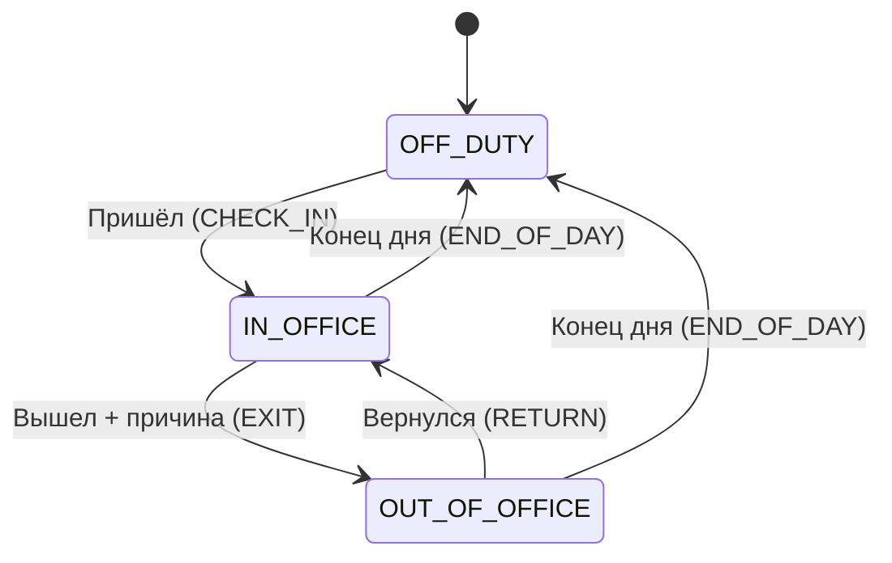

# SPEC — MarginFlow CRM Office

Техническое описание к [PRD.md](PRD.md). Стек и общие правила — в `CLAUDE.md`.

Соглашения:
- время хранится в **UTC**, показывается в часовом поясе офиса (`America/Los_Angeles`);
- «дата рабочего дня» — дата в часовом поясе офиса;
- все `id` — `cuid`, у всех моделей есть `createdAt` и `updatedAt`.

---

## 1. Данные (модели Prisma)

### User — учётная запись
| Поле | Тип | Примечание |
|---|---|---|
| login | string, unique | логин для входа: `имя.фамилия`, строчные, `[a-z0-9._-]{3,32}`, без учёта регистра |
| passwordHash | string | bcrypt (cost 10); открытый пароль нигде не хранится |
| role | `ADMIN` \| `MANAGER` \| `EMPLOYEE` | |
| locale | `ru` \| `en` \| `uz` | язык интерфейса и отчёта |
| isActive | boolean | уволенные не входят в систему |
| employeeId | → Employee, unique | 1:1 |

### Employee — сотрудник
| Поле | Тип | Примечание |
|---|---|---|
| firstName, lastName | string | вымышленные |
| position | string | Designer, Frontend Dev… |
| phone, email | string | фейковые (`555-01xx`, `@marginflow.test`) |
| avatarUrl | string? | заглушка |
| deskId | → Desk?, unique | одно место на сотрудника |
| status | `OFF_DUTY` \| `OUT_OF_OFFICE` \| `IN_OFFICE` | текущий статус, по умолчанию `OFF_DUTY` |
| currentExitReason | ExitReason? | причина, пока `OUT_OF_OFFICE` |
| trackByPhone | boolean | «Слежение по телефону», по умолчанию `false`; меняет ADMIN в форме сотрудника |

### Desk — рабочее место
| Поле | Тип | Примечание |
|---|---|---|
| code | string, unique | номер места: `01`, `07` |
| pcNumber | string?, unique | номер компьютера: `PC-07` |
| x, y | float 0..1 | центр места в **долях** ширины/высоты картинки плана |

Координаты хранятся в долях, а не в пикселях, поэтому места не съезжают при любом размере картинки на экране.

### Zone — зона на плане
| Поле | Тип | Примечание |
|---|---|---|
| name | string | «Кухня», «Переговорная» |
| kind | `KITCHEN` \| `MEETING_ROOM` \| `LOUNGE` \| `RECEPTION` \| `OTHER` | цвет зоны |
| x, y, width, height | float 0..1 | прямоугольник в долях картинки |

### OfficePlan — картинка плана (одна запись)
| Поле | Тип | Примечание |
|---|---|---|
| image | bytes? | PNG / JPG / WebP до 5 МБ (тип проверяется по первым байтам, SVG не принимается) |
| mimeType | string? | |

Если картинки нет, показывается тестовый план `public/office-plan-demo.svg` (1200×800).

### Client — клиент
| Поле | Тип | Примечание |
|---|---|---|
| companyName | string | вымышленная компания |
| contactName, phone, email | string | фейковые |
| city | string? | «Palo Alto, CA», «Tashkent, Uzbekistan» |
| address | string? | вымышленный адрес |
| lat, lng | float? | точка на карте (клик по карте или поиск через Nominatim) |
| notes | text? | |

### Request — заявка
| Поле | Тип | Примечание |
|---|---|---|
| clientId | → Client | |
| title, description | string, text | «Редизайн лендинга», «Встреча по ТЗ» |
| status | `NEW` \| `ASSIGNED` \| `IN_PROGRESS` \| `DONE` | новая / назначена / в работе / выполнена |
| assigneeId | → Employee? | ответственный |
| assignedAt | datetime? | когда назначен текущий ответственный (для ленты событий на главной админа) |
| dueDate | date? | срок; просроченные (срок прошёл, статус не `DONE`) подсвечиваются |

Правила статуса заявки:
- без ответственного заявка всегда `NEW`; `IN_PROGRESS` и `DONE` без ответственного нельзя;
- назначили ответственного на `NEW` → `ASSIGNED`;
- сняли ответственного → `NEW`;
- сотрудник меняет статус только своих заявок (`ASSIGNED` / `IN_PROGRESS` / `DONE`).

### WorkDay — рабочий день сотрудника
| Поле | Тип | Примечание |
|---|---|---|
| employeeId | → Employee | unique вместе с `date` |
| date | date | дата в часовом поясе офиса |
| checkInAt | datetime | первый приход |
| checkOutAt | datetime? | «Конец дня» |
| isLate | boolean | |
| lateMinutes | int | 0, если вовремя |
| closed | boolean | `true` после «Конца дня» или автозакрытия |
| autoClosed | boolean | закрыт системой в 23:59 |

### AttendanceEvent — журнал отметок
| Поле | Тип | Примечание |
|---|---|---|
| workDayId | → WorkDay | |
| type | `CHECK_IN` \| `EXIT` \| `RETURN` \| `END_OF_DAY` | |
| reason | ExitReason? | только для `EXIT` |
| requestId | → Request? | для `CLIENT_VISIT` |
| comment | string? | обязателен для `OTHER` |
| at | datetime | время события |
| createdById | → User | кто отметил (сам сотрудник или админ) |
| editedById, editReason | ?, string? | если админ исправлял |

`ExitReason`: `LUNCH`, `CLIENT_VISIT`, `MEETING`, `PERSONAL`, `OTHER`.

### LocationPoint — точка геолокации
| Поле | Тип | Примечание |
|---|---|---|
| workDayId | → WorkDay | без открытого дня точки нет |
| lat, lng | float | |
| accuracy | float | метры |
| at | datetime | |

### OfficeSettings — настройки (одна запись)
| Поле | Пример |
|---|---|
| workdayStart | `09:00` |
| lateGraceMinutes | `5` |
| timezone | `America/Los_Angeles` |
| officeName, officeAddress | MarginFlow HQ, вымышленный адрес в Palo Alto |
| officeLat, officeLng | `37.4419`, `-122.1430` |
| locationIntervalMinutes | `5` |
| locationRetentionDays | `30` |

### AgentToken — доступ ИИ-агента
| Поле | Тип | Примечание |
|---|---|---|
| name | string | «Claude assistant» |
| tokenHash | string | хранится только хэш (SHA-256) |
| lastUsedAt | datetime? | |
| revokedAt | datetime? | |

Модель пока не используется: агент подключается через MCP-сервер с ключом `MCP_API_KEY` (§7).

### Мок-данные (seed)
Сейчас в сиде:
- 13 пользователей: 1 админ (`olivia.bennett`), 2 менеджера (`daniel.brooks`, `sofia.ramirez`), 10 сотрудников (например, `mia.lopez`);
- пароли — из `.env` (`SEED_ADMIN_PASSWORD`, `SEED_MANAGER_PASSWORD`, `SEED_EMPLOYEE_PASSWORD`), по одному на роль;
- 20 рабочих мест `01`–`20` с компьютерами `PC-01`–`PC-20`, 13 заняты;
- 3 зоны: переговорная, зона отдыха, кухня (совпадают с тестовым планом);
- 7 клиентов: 5 в Калифорнии (Palo Alto, San Francisco, San Jose, Mountain View, Los Angeles) и 2 в Ташкенте;
- 10 заявок во всех статусах, одна просрочена;
- настройки офиса и демо-токен агента.

Позже добавится история посещаемости за 30 дней (с опозданиями, обедами и выездами).

### Управление сотрудниками (ADMIN)
- Админ создаёт и меняет сотрудников и менеджеров: имя, фамилия, должность, логин, пароль, роль (`EMPLOYEE`/`MANAGER`), рабочее место.
- Роль `ADMIN` через форму не выдаётся и не снимается.
- При изменении пароль можно оставить пустым — тогда он не меняется.
- Удаления нет: учётную запись можно отключить (`isActive = false`), тогда вход невозможен сразу же. Свою учётную запись админ отключить не может.
- Одно место — один сотрудник; занятое место выбрать нельзя.

---

## 2. Страницы

Все страницы находятся под `/[locale]/…` (`ru`, `en`, `uz`). Без входа доступна только `/login`.

| Страница | Что на ней | ADMIN | MANAGER | EMPLOYEE |
|---|---|---|---|---|
| `/login` | Вход, выбор языка | ✔ | ✔ | ✔ |
| `/dashboard` | «Мой день» (приход, опоздание, уход, кнопка «Закончить работу»), счётчики «в офисе / вне офиса / не на работе». ADMIN — своя главная: цифры (в офисе, вне офиса, не пришли, опоздали, заявок в работе), мини-карта офиса (точки только тех, кто в офисе; при наведении — имя, место или зона, время последней отметки) и лента последних событий (приход, выход, возврат, конец дня, назначена заявка). Всё обновляется раз в 3 с без перезагрузки; ниже — «Не отметились» и «Опоздали сегодня» | ✔ | ✔ | ✔ |
| `/attendance` | Большие кнопки отметок + мой день + моя история | ✔ | ✔ | ✔ |
| `/employees` | Список с фильтром по статусу и поиском | ✔ (правка) | ✔ | ✔ (просмотр) |
| `/employees/[id]` | Карточка, место, история дней | ✔ | ✔ | только свои отметки |
| `/clients` | Список клиентов + карта всех точек, поиск | ✔ | ✔ | только просмотр |
| `/clients/new`, `/clients/[id]/edit` | Форма клиента с выбором точки на карте; заявки клиента | ✔ | ✔ | ✖ |
| `/requests` | Заявки: вкладки-фильтр по статусу, назначение и статус прямо в списке | ✔ | ✔ | свои заявки (меняет статус) |
| `/requests/new`, `/requests/[id]/edit` | Форма заявки | ✔ | ✔ | ✖ |
| `/office-plan` | План: места, кто сидит и его статус, зоны. Админ: загрузка картинки, места (клик), перетаскивание, зоны (рамка мышью), привязка сотрудника | ✔ (правка) | ✔ | ✔ |
| `/map` | «На карте города» (OpenStreetMap): офис, заявки (клиенты с открытыми заявками), сотрудники вне офиса. Клиенты дальше 120 км друг от друга — разные города, сверху переключатель городов. Клик по сотруднику — имя, причина выхода, время выхода. Вернулся в офис — пропадает с карты. Обновление раз в 3 с | ✔ | ✔ | ✖ |
| `/track/[employeeId]` | «Слежение»: живой маршрут сотрудника с «Слежение по телефону» за сегодня: точка прихода, текущая точка, круг точности, путь, скорость, события дня. Обновление раз в 3 с. Ссылка — на странице карты и в поиске. Для остальных сотрудников — страница «не найдено» | ✔ | ✔ | ✖ |
| `/reports` | Период + сотрудник → «Скачать Excel» | ✔ | ✔ | ✖ |
| `/settings` | Рабочий день, допуск, часовой пояс, места, токены агента | ✔ | ✖ | ✖ |

Видимость для сотрудника:
- коллеги отображаются со статусом;
- причина выхода видна только для `LUNCH`, `CLIENT_VISIT` и `MEETING`;
- `PERSONAL` и `OTHER` показываются просто как «Вне офиса».

Данные на плане, карте и дашборде обновляются опросом раз в 15–30 секунд.

---

## 3. Статусы



| Действие | Из статуса | В статус | Что записываем |
|---|---|---|---|
| Пришёл | `OFF_DUTY` | `IN_OFFICE` | новый `WorkDay` + `CHECK_IN`, расчёт опоздания |
| Вышел (LUNCH / CLIENT_VISIT / MEETING / PERSONAL / OTHER) | `IN_OFFICE` | `OUT_OF_OFFICE` | `EXIT` + `reason` |
| Вернулся | `OUT_OF_OFFICE` | `IN_OFFICE` | `RETURN` |
| Конец дня | `IN_OFFICE`, `OUT_OF_OFFICE` | `OFF_DUTY` | `END_OF_DAY`, `checkOutAt`, `closed = true` |

**Обязательная отметка прихода.** У `EMPLOYEE` и `MANAGER` в рабочий день (пн–пт) вместо любой страницы показывается экран «Я пришёл»: время офиса, своё рабочее место (код, ПК, место на плане) и кнопка. Пока нет `WorkDay` за сегодня, меню скрыто. ADMIN отмечается по желанию — через карточку «Мой день» на главной. Кнопка «Закончить работу» — это `END_OF_DAY` (время ухода → `checkOutAt`).

В интерфейсе «Конец дня» — это одна из причин в меню «Вышел». Для пользователя это так, но в API это отдельный тип события.

Ошибки (API отвечает `409 Conflict` с кодом ошибки):
- `ALREADY_CHECKED_IN` — повторный «Пришёл» при открытом дне;
- `DAY_ALREADY_CLOSED` — «Пришёл» после «Конца дня» в ту же дату (повторно открыть день может только ADMIN);
- `INVALID_TRANSITION` — «Вернулся» из `IN_OFFICE`, «Вышел» из `OFF_DUTY` и т. п.;
- `COMMENT_REQUIRED` — `OTHER` без комментария.

**Автозакрытие:** если сотрудник забыл нажать «Конец дня», в 23:59 по времени офиса день закрывается:
- `END_OF_DAY` пишется с `autoClosed = true`, `checkOutAt` = время последнего события;
- статус становится `OFF_DUTY`, геолокация останавливается.

---

## 4. Опоздания

```
start      = дата дня + workdayStart (09:00) в timezone офиса
graceEnd   = start + lateGraceMinutes (5) минут
diffSec    = checkInAt − start (в секундах)

isLate      = checkInAt ≥ graceEnd + 60 с     // 09:06:00 и позже
lateMinutes = isLate ? floor(diffSec / 60) : 0
```

| Приход | isLate | lateMinutes |
|---|---|---|
| 08:47 | нет | 0 |
| 09:00:00 | нет | 0 |
| 09:05:59 | нет | 0 |
| 09:06:00 | **да** | 6 |
| 09:20:30 | **да** | 20 |
| 10:30 | **да** | 90 |

Правила:
- считается только **первый** `CHECK_IN` за дату; выходы и возвраты днём на опоздание не влияют;
- рабочие дни — пн–пт. В субботу и воскресенье можно отметиться, но опоздание не считается;
- если ADMIN исправляет время прихода, `isLate` и `lateMinutes` пересчитываются, а в событие записываются `editedById` и `editReason`;
- параметры берутся из `OfficeSettings`, в коде они не захардкожены.

---

## 5. Геолокация

- Точки собираются только при **открытом** `WorkDay`, от «Пришёл» до «Конец дня».
- Когда отправляются точки:
  - при каждом событии (`CHECK_IN`, `EXIT`, `RETURN`, `END_OF_DAY`);
  - в статусе `OUT_OF_OFFICE` — раз в минуту, пока открыта вкладка сайта;
  - у сотрудника с `trackByPhone` — раз в 10 с от прихода до конца дня, после кнопки «Включить слежение» (см. 5.3).
- Сервер **отклоняет** точку (`403 LOCATION_NOT_ALLOWED`), если у сотрудника нет открытого дня или статус `OFF_DUTY`.
- Отображение:
  - `IN_OFFICE` — на плане, на своём месте;
  - `OUT_OF_OFFICE` — последняя точка на карте с причиной и временем;
  - `OFF_DUTY` — нигде.
- Если браузер не дал доступ к геолокации, отметка всё равно работает. На карте сотрудник попадает в список «Вне офиса, место неизвестно».
- Точки старше `locationRetentionDays` (30 дней) удаляются ежедневной очисткой: `/api/cron/retention` с ключом `CRON_SECRET`, локально `npm run db:cleanup`. Отчёты считаются по событиям, поэтому не меняются.
- Открытие страницы слежения записывается в `AuditLog` (`track.view`, не чаще раза в час на пару зритель + сотрудник); админ видит список на `/track/[id]`.
- В демо точки вымышленные: Palo Alto, Mountain View, Menlo Park.

### 5.1. Общий приём позиций
Все позиции попадают в одно место — `ingestPositions()` в `src/lib/positions.ts`. Источники:
- имитация движения (`SIMULATOR`) — вызывает функцию прямо внутри сервера;
- датчики и трекеры (`SENSOR`) — `POST /api/positions` с заголовком `Authorization: Bearer <POSITIONS_API_TOKEN>`, могут присылать позиции любого сотрудника;
- телефон (`PHONE`) — тот же адрес с сессией входа, только свои точки и только в городе.

Тело запроса: `{ "positions": [{ "employeeId", "at"?, "office"?: { "x", "y" }, "geo"?: { "lat", "lng", "accuracy"? } }] }`.
- `office` — точка на плане, доли 0..1;
- `geo` — координаты WGS84.

Ответ: `{ accepted, rejected: [{ employeeId, reason }] }`. Причины отказа:
- `offDuty` — нет открытого дня или статус `OFF_DUTY`;
- `notInOffice` — точка на плане, а статус не `IN_OFFICE`;
- `badTime` — время из будущего или раньше прихода;
- `unknownEmployee` — такого сотрудника нет.
- `too_often` — точка телефона пришла слишком рано после предыдущей: меньше 8 с при `trackByPhone`, меньше 50 с у остальных. Для `SIMULATOR` и `SENSOR` этого ограничения нет.

Хранение:
- точка на плане — последняя в `Employee.planX / planY / planAt`. Если она старше 60 с, сотрудник рисуется на своём месте;
- точки в городе — история в `LocationPoint` (поле `source`).

### 5.2. Имитация движения
- Двигатель (`src/lib/simulation/engine.ts`) запускается вместе с сервером (`src/instrumentation.ts`) и делает шаг раз в 3 с, пока `OfficeSettings.simulationEnabled = true`.
- Включение и выключение:
  - командами `npm run sim:on` / `npm run sim:off`;
  - кнопкой у ADMIN на страницах «План офиса» и «Карта».
- Пока имитация включена, у всех в шапке горит значок «Имитация».
- Для демо имитация «приводит» в офис всех активных сотрудников без рабочего дня сегодня: приход в случайное время около начала дня (±20 мин, не позже «сейчас»), опоздание считается по обычному правилу. Кто уже нажал «Закончить работу» — не трогается.
  - `IN_OFFICE`: место → случайная точка в зоне `KITCHEN` или `MEETING_ROOM` → место, с паузами.
  - `OUT_OF_OFFICE`:
    - при выезде или встрече едет к клиенту заявки — из события `EXIT`, иначе к ближайшей по сроку открытой заявке. Клиент должен быть не дальше 80 км;
    - на обеде, по личным делам или без подходящей заявки гуляет в радиусе ~3 км. Движение по прямой, ускорено для наглядности.
- План офиса и карта опрашивают `GET /api/presence` и `GET /api/presence/map` раз в 3 с (TanStack Query).

### 5.3. Слежение по телефону
- Включается флагом `Employee.trackByPhone`. В демо это вымышленный сотрудник `field.tracker`, имитация его не двигает.
- На телефоне после прихода видна карточка «Включить слежение»: высокая точность, отправка раз в 10 с, запрет засыпания экрана (Wake Lock), точность и время последней отправки. Точки старше 60 с не отправляются. Браузер не шлёт точки, если страница закрыта или телефон заблокирован.
- Правило рабочего дня не меняется: без открытого дня сервер отклоняет точку (`offDuty`).
- Страница `/track/[employeeId]` и `GET /api/track/{employeeId}` доступны ADMIN и MANAGER.
- Для проверки с телефона `npm run tunnel` даёт временный адрес `https://…trycloudflare.com`. Быстрый вход (`/api/dev-login`, провайдер `dev-login`) работает только на localhost, через туннель вход только по паролю.

---

## 6. Отчёт в Excel

Страница `/reports` (ADMIN, MANAGER): выбрать период (по умолчанию — с 1-го числа месяца по сегодня) → «Скачать отчёт в Excel».
Файл: `GET /api/reports/attendance.xlsx?from=YYYY-MM-DD&to=YYYY-MM-DD&locale=ru` — не больше 366 дней.
Доступ: ADMIN, MANAGER (`EMPLOYEE` → `403`, без входа → `401`, неверный период → `400`).
Генерация — ExcelJS (`src/lib/excel.ts`), расчёт — `src/lib/report.ts` (его же использует MCP-сервер).
Заголовки — на языке пользователя. Имя файла: `marginflow-attendance-2026-10-01_2026-10-31.xlsx`.

**Лист 1 «Сводка»** — одна строка на каждого активного сотрудника (и с 0 дней — видно отсутствие):

| Сотрудник | Должность | Дней на работе | Опозданий | Опоздание, мин всего | В офисе (ч:мм) | Вне офиса (ч:мм) |
|---|---|---|---|---|---|---|

Внизу — строка «Итого» (формулы `SUM`).

**Лист 2 «По дням»** — одна строка на сотрудника за день:

| Дата | Сотрудник | Приход | Уход | Опоздание, мин | В офисе (ч:мм) | Вне офиса (ч:мм) | Выходы |
|---|---|---|---|---|---|---|---|

«Выходы» — причина и время, например `Обед 13:00–14:00`. Если день ещё идёт — в «Уход» пишется «на работе».

Как считаются часы (по событиям дня):
- `CHECK_IN` / `RETURN` — начинается время «в офисе»; `EXIT` — время «вне офиса»; `END_OF_DAY` — часы останавливаются;
- сегодняшний незакрытый день считается до текущего момента, незакрытый прошлый — до последнего события.

Пример: приход 09:12, обед 13:00–14:00, уход 18:00 → опоздание **12 мин**, в офисе **7 ч 48 мин**, вне офиса **1 ч**.

Оформление:
- тёмная закреплённая шапка, автофильтр, рамки, «зебра»;
- часы — настоящие значения Excel в формате `[ч]:мм` (их можно суммировать), 0 минут опоздания показывается как «—»;
- строки с опозданием подсвечены светло-красным.

---

## 7. ИИ-агент (MCP-сервер)

Папка `mcp-server/`, запуск `npm run mcp` → `http://127.0.0.1:3333/mcp` (Streamable HTTP, без сессий; слушает только этот компьютер).
Код CRM (`src/lib`) переиспользуется напрямую, база — та же.

- **Ключ:** каждый запрос — с заголовком `Authorization: Bearer <MCP_API_KEY>`. Ключ лежит только в `.env` (не короче 32 символов), без него сервер не запускается. Без ключа или с неверным ключом — `401` и понятное сообщение, никакие данные не отдаются. Сравнение — по хэшу, за постоянное время.
- **Подключение агента:** `.mcp.json` в корне проекта (в `.gitignore`) — сервер `marginflow-crm`, тип `http`, тот же ключ в заголовке.
- **Права:** как у MANAGER. Изменение одно — назначение заявки. Агент не видит пароли, хэши и ключи; координаты — только последняя точка за текущий рабочий день.
- **Время** в ответах — офисное (`America/Los_Angeles`), `HH:mm`.
- **Ошибки** приходят текстом: `Ошибка <КОД>: что случилось` + `Что сделать: …`. Коды: `EMPLOYEE_NOT_FOUND`, `EMPLOYEE_AMBIGUOUS`, `EMPLOYEE_NOT_IN_OFFICE`, `EMPLOYEE_INACTIVE`, `REQUEST_NOT_FOUND`, `REQUEST_AMBIGUOUS`, `REQUEST_DONE`, `REQUEST_ALREADY_ASSIGNED`, `NO_FREE_EMPLOYEE`, `BAD_DATE`, `BAD_PERIOD`, `PERIOD_TOO_LONG`, `DB_UNAVAILABLE`, `INTERNAL`.

| Инструмент | Что делает |
|---|---|
| `where_is_everyone` (`status?`) | Все активные сотрудники: в офисе (место, зона на плане, время прихода), вне офиса (причина, заявка, последняя точка), не на работе (когда закончил день). Итоги по статусам. |
| `find_employee` (`query`) | Поиск по имени, фамилии, части имени или логину: должность, контакты, место и ПК, статус, сегодняшний приход и опоздание, число открытых заявок. |
| `late_today` | Кто сегодня опоздал и на сколько минут (от 09:00), кто ещё не отметился после 09:05:59 (кроме админов). |
| `attendance_summary` (`from`, `to`, `employee?`) | Как Excel-отчёт: по каждому — дни, опоздания, часы в офисе и вне офиса; для одного сотрудника — ещё и по дням. |
| `assign_request` (`request`, `employee?`, `reassign?`) | Назначить заявку (ID или часть названия / компании). Без `employee` — самому свободному: в офисе, не админ, меньше всего открытых заявок. `NEW` → `ASSIGNED`. Выполненные не назначаются; уже назначенные — только с `reassign: true` и при `MCP_ALLOW_REASSIGN=1` на сервере (по умолчанию выключено). Каждое назначение пишется в `AuditLog`. |

Примеры вопросов к агенту:
- «Где сейчас все?», «Кто сейчас вне офиса и почему?»
- «Найди Софию — на месте ли она?»
- «Кто сегодня опоздал и на сколько?»
- «Сводка прихода и ухода Mia Lopez за октябрь».
- «Назначь заявку Analytics setup свободному сотруднику в офисе».

---

## 8. API для интерфейса (кратко)

Все запросы идут с сессией Auth.js. Входные данные проверяются через Zod. Права проверяются на сервере.

| Метод | Путь | Кто | Назначение |
|---|---|---|---|
| POST | `/api/attendance/check-in` | все | Пришёл |
| POST | `/api/attendance/exit` | все | Вышел: `{ reason, requestId?, comment? }` |
| POST | `/api/attendance/return` | все | Вернулся |
| POST | `/api/attendance/end-of-day` | все | Конец дня |
| GET | `/api/attendance/me?from&to` | все | Мои дни и события |
| PATCH | `/api/attendance/events/{id}` | ADMIN | Исправить отметку: `{ at, editReason }` |
| POST | `/api/attendance/workdays/{id}/reopen` | ADMIN | Повторно открыть день |
| POST | `/api/location` | все | Точка `{ lat, lng, accuracy }` (только при открытом дне) |
| GET | `/api/presence` | все* | Статусы и места для плана и дашборда (*причины выхода фильтруются по роли) |
| GET | `/api/presence/map` | ADMIN, MANAGER | Последние точки сотрудников вне офиса |
| GET | `/api/track/{employeeId}` | ADMIN, MANAGER | Маршрут за сегодня, расстояние, события (403 — сотрудник, 404 — без `trackByPhone`) |
| GET | `/api/dashboard` | ADMIN | Цифры и лента событий для главной админа |
| — (Server Action `saveEmployee`) | `/employees/new`, `/employees/[id]/edit` | ADMIN | Создать/изменить сотрудника (формы сайта работают через Server Actions) |
| — (Server Actions `saveClient`) | `/clients/new`, `/clients/[id]/edit` | ADMIN, MANAGER | Создать/изменить клиента |
| — (Server Actions `saveRequest`, `assignRequest`, `setRequestStatus`) | `/requests…` | ADMIN, MANAGER; EMPLOYEE — статус своих заявок | Заявки |
| — (Server Actions `uploadPlan`, `resetPlan`, `saveDesk`, `moveDesk`, `deleteDesk`, `saveZone`, `deleteZone`) | `/office-plan` | ADMIN | Редактор плана |
| GET | `/api/office-plan/image` | все после входа | Загруженная картинка плана (`nosniff`) |
| GET | `/api/reports/attendance.xlsx` | ADMIN, MANAGER | Excel-отчёт |
| GET/PATCH | `/api/settings` | ADMIN | Настройки офиса |
| GET/POST/DELETE | `/api/agent-tokens` | ADMIN | Токены агента |

---

## 9. Интерфейс (UI) — «Human Liquid Glass»

Цель — дорогой, спокойный и «человечный» интерфейс: стекло и глубина, мягкая физика движения, бережность к глазам.

### 9.1. Слои глубины
| Слой | Что | Материал (утилита в `globals.css`) |
|---|---|---|
| L0 подложка | фон страницы | размытое фото офиса `public/backdrop/office.{avif,webp}` + вуаль темы + зерно (`.app-backdrop`) |
| L1 поверхность | таблицы, формы, списки | почти непрозрачная (`surface`) |
| L2 стекло | сайдбар, шапка, плитки, рамки плана и карты | blur 24 px, saturate 180 % (`glass`, `glass-strong`) |
| L3 оверлей | окна, Ctrl+K, тосты, попапы карты | blur 32 px, большая мягкая тень (`glass-overlay`) |

Вдавленные дорожки (вкладки, сегменты) — `inset-well`, бегунок — `lens`. Без `backdrop-filter`, при `prefers-reduced-transparency` — непрозрачные поверхности; при `prefers-contrast: more` — плотные рамки.

### 9.2. Цвета и тема
- Токены в `globals.css`: нет чистого белого и чёрного; акцент — изумруд (`--primary`).
- Сигналы: `sig-in` (в офисе), `sig-out` (вне офиса), `sig-off` (не на работе), `sig-late` (опоздание/просрочка), `sig-info` (заявки), `sig-violet`. Хардкод цветов палитры Tailwind не используется.
- Статус никогда не показывается только цветом: точка + текст (или иконка).
- Тема: системная / светлая / тёмная (`next-themes`), переключатель в сайдбаре, на странице входа и в Ctrl+K. Тайлы карты в тёмной теме приглушаются фильтром.

### 9.3. Движение
- Библиотека `motion`; пресеты в `src/lib/motion.ts` (`snappy`, `smooth`, `gentle`) и кривые `--ease-spring`, `--ease-out-soft`.
- Окна «вырастают» из кнопки, которая их открыла; бегунки вкладок и меню скользят (`layoutId`); блоки появляются при прокрутке (`Reveal`).
- Люди на плане и карте плавно едут к новой точке (обновление раз в 3 с); место на плане мягко «садится» после перетаскивания.
- `prefers-reduced-motion` отключает анимации.

### 9.4. Эргономика
- Десктоп — стеклянный сайдбар (сворачивается в рельс); телефон — верхняя панель и нижний таб-бар, кнопка дня в зоне большого пальца.
- Таблицы на ширине < 640 px превращаются в карточки; горизонтальной прокрутки нет.
- Формы: подпись над полем, ошибка сразу под полем, состояние на кнопке отправки; удаление — через окно подтверждения (не `window.confirm`).
- Каждое действие даёт отклик: тост («Статус обновлён», «Сохранено» и т. д.).
- Клавиатура: Ctrl+K — палитра (разделы, поиск, действия дня, тема, язык), «/» — поиск, Esc — закрыть.

### 9.5. Компоненты
`src/components/ui/`: `button`, `card`, `input`, `badge`, `table`, `dialog` (+ `ConfirmDialog`), `toast`, `switch`, `segmented`, `tooltip`, `avatar` (инициалы + личный цвет по id), `skeleton`, `number-ticker`, `reveal`, `theme-switcher`.
Общие: `page.tsx` (`PageHeader`, `EmptyState`, `ResponsiveList`), `form-field.tsx`, `search-field.tsx`, `link-tabs.tsx`, `command-palette.tsx`, `map/markers.ts` (маркеры-аватары карты).
